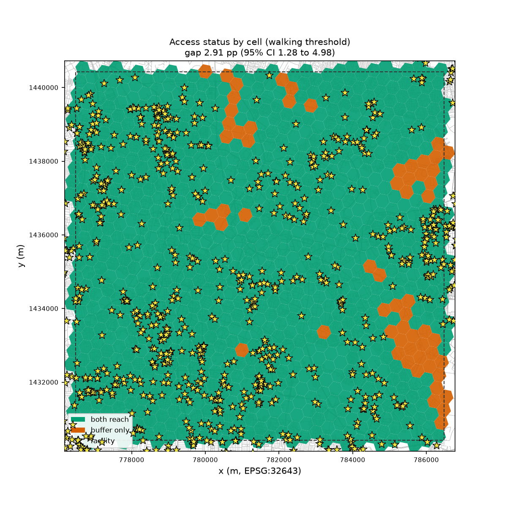
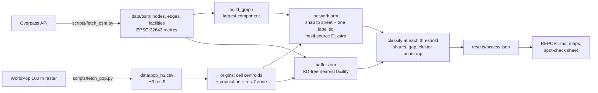

# Walkable Access

> How much does a straight-line walking buffer overstate access to hospitals and clinics, compared
> with walking on the street network? Measured on central Bengaluru, weighted by population.

[](https://github.com/Prithv122/geo-graph/actions/workflows/ci.yml)

**Live demo:** not deployed. It runs locally in about 10 seconds from the committed data.
**Stack:** Python 3.12 · networkx · shapely + pyproj · h3 · scipy · pandas · OpenStreetMap (osmnx,
fetch only) · WorldPop (rasterio, fetch only) · matplotlib

**Result in one line:** at 15 minutes and 5 km/h, the straight-line buffer says **100.00%** of
1.06 million residents can walk to a hospital or clinic; the street network says **97.09%**. The gap
is **2.91 percentage points** (95% CI 1.28 to 4.98), below the pre-registered 5 pp, so **H1 is not
supported**. At a 10-minute walk the gap is 9.89 pp.



---

## 1. The problem

"Share of people within 15 minutes' walk of a hospital" is a common planning and analytics number,
and the quick way to compute it is a straight-line circle around each facility. People walk on
streets, not in straight lines: walls, rail lines, campuses and one-way blocks add distance. If the
circle overstates access, the people it miscounts are exactly the ones a health-access study is
meant to find. This repo measures by how much, and where, for one dense city centre, with the method
fixed in advance.

## 2. The data

| | |
|---|---|
| Street network and facilities | OpenStreetMap via the Overpass API (osmnx `walk` filter), fetched 2026-10-23. 77,717 nodes and 106,973 edges in the connected walking network; 1,419 facilities (`amenity=hospital` 728, `clinic` 634, `doctors` 57), 689 of them inside the study area |
| Population | WorldPop Global2 R2025A, constrained 100 m, India, 2025: 1,059,315 residents in the study area, summed to 973 H3 resolution-9 cells (27 resolution-7 zones) |
| Study area | A 10 km x 10 km square centred on 12.9716 N, 77.5946 E (central Bengaluru), in EPSG:32643. Network and facilities extend 2.5 km beyond it |
| Licence | OSM: ODbL 1.0; the committed extract is a derived database and stays ODbL. WorldPop: CC BY 4.0. Details and the raster's SHA-256 in [`data/ATTRIBUTION.md`](data/ATTRIBUTION.md) |
| Refresh | One-off. The extract (about 6.5 MB) is committed, so tests and CI never touch the network |

WorldPop describes R2025A as an alpha release. The population is a modelled estimate, not a census.

## 3. Architecture



`geonet access` computes both distances once per cell and then classifies them at all nine
speed x time thresholds, so the whole sensitivity grid costs one Dijkstra.

## 4. Key decisions & tradeoffs

| Decision | Chose | Over | Why |
|---|---|---|---|
| What may differ between arms | Only the distance method; a test swaps the network distance for the straight line and asserts a gap of exactly zero at every threshold | Two separate pipelines | Destinations, study area, population weights and threshold are shared objects, so the gap cannot come from anything but the distance |
| Joining the network | Snap to the nearest point on the nearest **street**, then walk along it to either end (Amendment 1) | Nearest **node** (the brief's plan, and the common shortcut) | A pre-run review showed the nearest node can lie behind the resident and add up to two edge lengths, inflating the gap in one direction only. Nearest-node is kept as a sensitivity: here it gives 2.89 pp, almost the same, because central Bengaluru's edges are short |
| Metric for everything | Projected metres (UTM 43N), edge lengths recomputed from projected geometry | Geodesic edge lengths from OSM tools | Mixing two metrics let a walk come out centimetres shorter than the straight line. With one metric, "network >= straight line" holds exactly, and both `build_graph` and `run_access` refuse data that breaks it |
| Uncertainty | Cluster bootstrap over the 27 resolution-7 zones | Resampling single cells | Neighbouring cells share streets and facilities, so they are not independent. The cell-level CI ([2.13, 3.78]) is less than half as wide, which is the overconfidence this avoids |
| One Dijkstra, no cutoff | A labelled multi-source Dijkstra from every facility at once, which also records which facility each node reached | Nine cutoff runs, or networkx with a virtual super-source | Every threshold becomes a comparison, circuity is defined for cells beyond the threshold too, and the chosen facility is known for the spot-check |
| Edge of the study area | Network and facilities fetched 2.5 km beyond the AOI; population counted inside it | Clipping everything to the AOI | A resident at the edge may walk to a clinic just outside it. Clipping would make the edge look underserved in both arms |
| Pre-registration | Question, arms, decision rule, CI and sensitivities committed before data; two dated amendments, both before any real number | Choosing the threshold after looking | Several thresholds give very different gaps (0.40 to 14.95 pp). Fixing 15 minutes in advance is what makes 2.91 pp the answer rather than a pick |

## 5. Results

Registered analysis: 5 km/h, 15 minutes (1,250 m), 2,000 cluster-bootstrap resamples, seed
20261023, run from commit `143102b` on the committed data. `tests/test_results.py` reruns it and
checks every headline number below against `results/access.json`.

| Metric | Value | Notes |
|---|---|---|
| Residents with access, straight-line buffer | **100.00%** | Every cell centroid is within 1,250 m of a facility (farthest: 1,221 m) |
| Residents with access, walking network | **97.09%** | |
| Gap (buffer minus network) | **2.91 pp**, 95% CI [1.28, 4.98] | Cluster bootstrap over 27 zones |
| Pre-registered verdict | **H1 not supported** | H1 needed >= 5 pp with a lower bound >= 2 pp. Not the registered null either (upper bound >= 2 pp): the gap is real but small |
| Residents the buffer wrongly counts as served | 30,821 | 61 of 973 cells; their median distance is 686 m straight and 1,414 m on foot |
| Circuity (network / straight line), population-weighted | median 1.57, 90th percentile 2.91 | Short trips: the median straight-line distance to care is only 249 m |
| Nearest-node snapping (superseded) | 2.89 pp [1.21, 4.93] | Sensitivity for Amendment 1 |
| H3 resolution 10 instead of 9 | 2.35 pp [1.05, 3.98] | Descriptive; mostly reflects how 100 m pixels fall into smaller cells |
| Snapping | median 11 m; 0.61% of residents more than 200 m from a street | |
| Owner spot-check against an independent router | **Not done yet** | 20 seeded cells in [`results/spot_check.md`](results/spot_check.md); until it passes, the result is "not validated by the spot-check" |

**Sensitivity to the threshold.** The gap depends almost entirely on the distance threshold, because
the straight-line buffer hits a ceiling: with 689 facilities in 100 km^2, nearly everyone is close
as the crow flies.

| Threshold | Buffer | Network | Gap [95% CI] |
|---|---|---|---|
| 667 m (4 km/h, 10 min) | 97.03% | 82.09% | 14.95 pp [10.56, 19.60] |
| 833 m (5 km/h, 10 min) | 99.30% | 89.41% | 9.89 pp [5.98, 14.46] |
| 1,000 m (4 x 15 or 6 x 10) | 99.89% | 94.17% | 5.72 pp [2.79, 9.17] |
| **1,250 m (5 km/h, 15 min)** | **100.00%** | **97.09%** | **2.91 pp [1.28, 4.98]** |
| 1,333 m (4 km/h, 20 min) | 100.00% | 98.10% | 1.90 pp [0.72, 3.38] |
| 1,500 m (6 km/h, 15 min) | 100.00% | 98.98% | 1.02 pp [0.33, 1.85] |
| 1,667 m (5 km/h, 20 min) | 100.00% | 99.14% | 0.86 pp [0.25, 1.63] |
| 2,000 m (6 km/h, 20 min) | 100.00% | 99.60% | 0.40 pp [0.05, 0.91] |

**Where.** The gap is concentrated, not spread evenly: 7 of 27 zones have a gap above 7 pp, the
worst 20.2 pp (zone centred near 13.023 N, 77.600 E) and 18.5 pp (near 12.993 N, 77.633 E, 7,410
residents affected). The full tables and the zone map are in [`results/REPORT.md`](results/REPORT.md).
What sits in those zones (closed grounds, rail lines, campuses) has not been checked on the ground.

**What this means.** In a facility-dense centre, the straight-line method is wrong for a few
specific neighbourhoods rather than for the city as a whole, and its error grows quickly as the
threshold tightens: at a 10-minute walk it would overstate access by about 10 points. One city
centre with dense OSM health mapping is the easy case for the buffer; a sparser suburb is where the
registered 5 pp could be crossed, and that is untested here.

**Threats to validity.** OSM completeness (missing clinics or footpaths; private campus paths mapped
as public); `amenity=doctors` and `clinic` include small practices, which is why the facility count
is high; snapping from cell centroids rather than homes; one walking speed for everyone; the 100 m
raster and H3 cell size; a percentile bootstrap over only 27 zones can still be narrow; one AOI in
one city; and access defined as distance only (no opening hours, capacity, cost or safety).

## 6. How to run

```bash
git clone https://github.com/Prithv122/geo-graph.git
cd geo-graph
uv sync --all-groups --extra maps
uv run pytest
uv run geonet build                      # graph and facility counts
uv run geonet access                     # registered run -> results/access.json
uv run geonet report --spot-check        # REPORT.md, figures, spot-check sheet
uv run geonet access --pop data/pop_h3_r10.csv   # resolution-10 sensitivity
uv run geonet access --synthetic         # the seeded grid with a river, no data needed
```

Any setting other than the registered one (speed, minutes, resamples, seed, study area) still runs
but is labelled "not the registered analysis" and gets no verdict.

Spot-check: open each link in `results/spot_check.md`, fill `router_m` in `results/spot_check.csv`,
then `uv run geonet score-spot-check results/spot_check.csv --access results/access.json`.

Re-fetching the data (optional, needs the network and about 800 MB for the raster):
`uv sync --extra fetch`, then `uv run python scripts/fetch_osm.py` and
`uv run python scripts/fetch_pop.py`. OSM changes daily, so a re-fetch will not reproduce the
committed numbers exactly; the committed extract is the analysis input.

## 7. What I'd change at 100x scale

- **Many cities:** the pure-Python Dijkstra takes a few seconds for 78k nodes. For a country,
  move the graph to a compiled router (OSRM or Valhalla with a foot profile, or `scipy.sparse.csgraph`
  on a CSR matrix) and run one multi-source search per city in parallel.
- **Data:** an Overpass query per city does not scale and stresses a shared service; use a regional
  `.osm.pbf` extract from Geofabrik with `pyrosm` or `osmium`, and DuckDB-spatial for the H3
  aggregation of population.
- **Better origins:** replace cell centroids with building footprints (or population-weighted
  points) so snapping error stops depending on cell size.
- **Beyond distance:** add travel time by mode, opening hours and facility type (a hospital is not a
  GP clinic), which a planning use would need.

---

## References

- Pre-registration and amendments: [`PREREGISTRATION.md`](PREREGISTRATION.md). Build notes:
  [`NOTES.md`](NOTES.md).
- Boeing, G. (2017). OSMnx: New methods for acquiring, constructing, analyzing, and visualizing
  complex street networks. *Computers, Environment and Urban Systems* 65, 126–139 (used for the
  one-off download only).
- WorldPop R2025A, DOI 10.5258/SOTON/WP00839; OpenStreetMap contributors (ODbL).
- Uber H3 hexagonal grid (`h3` Python bindings, v4).
