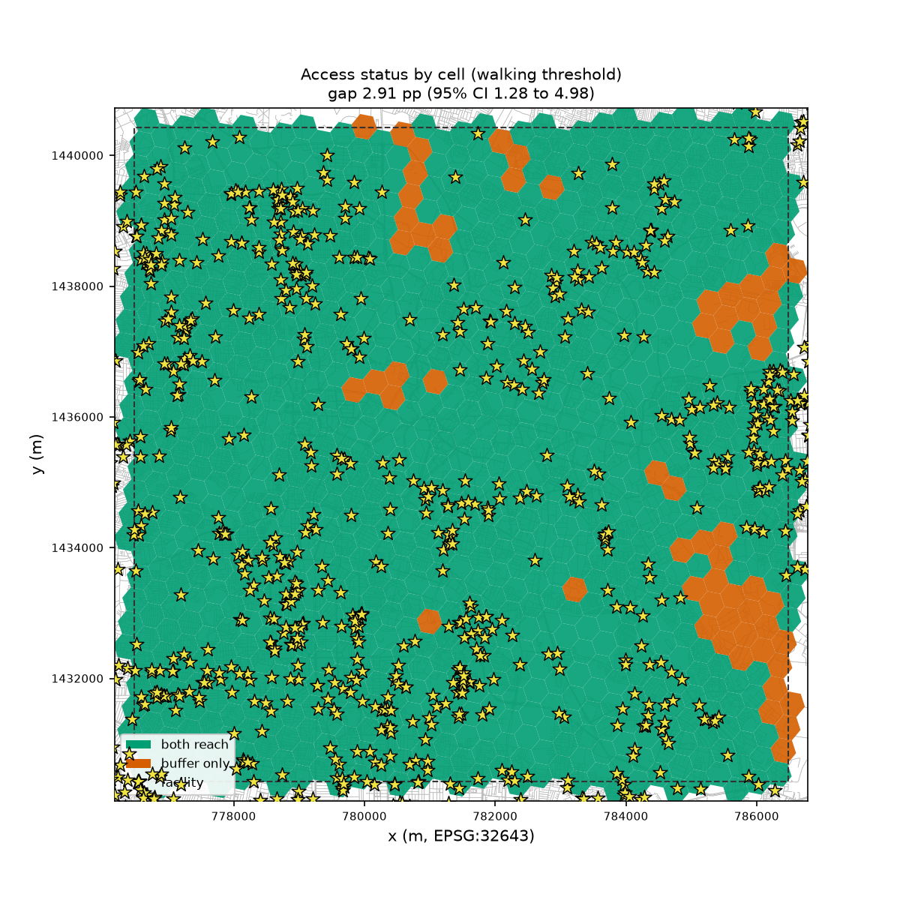
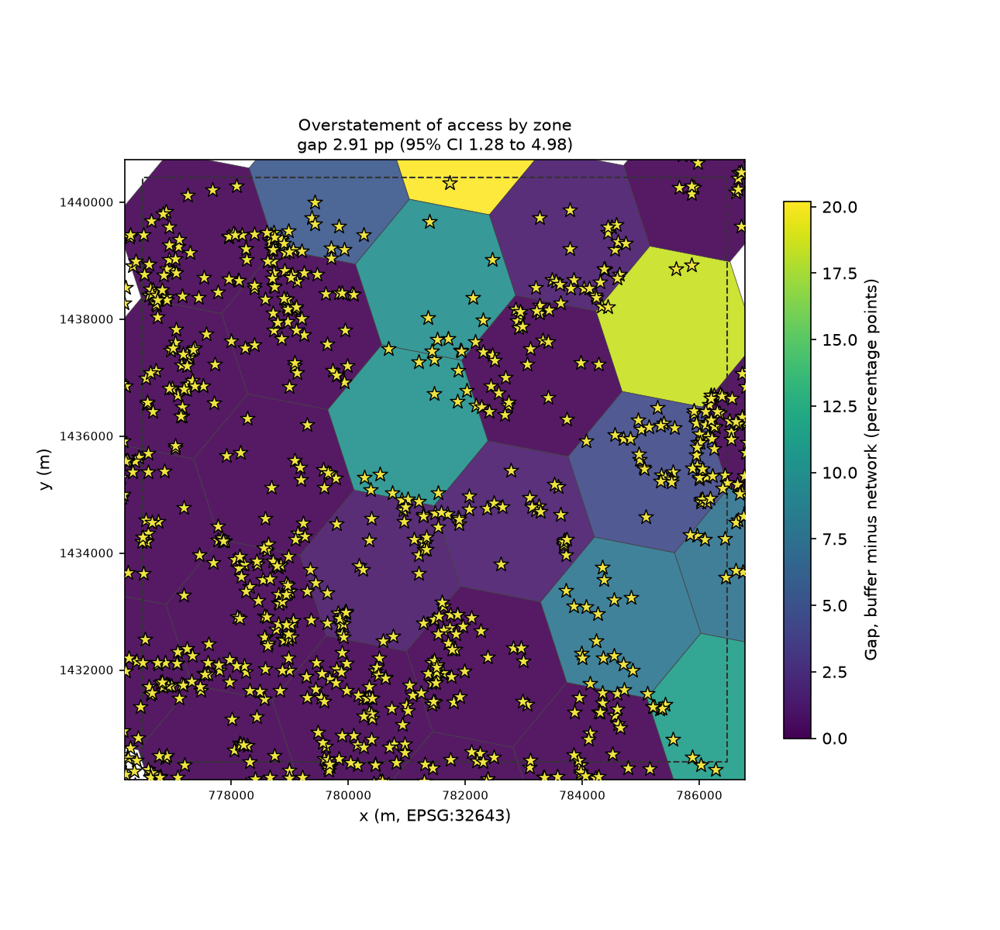
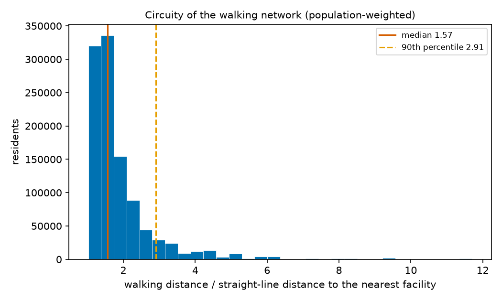

# Walkable access: straight-line buffer vs walking network

Headline: the straight-line buffer overstates access by **2.91 pp** (95% cluster-bootstrap CI [1.28, 4.98] pp) at 1,250 m. Verdict: **H1 not supported**.

Study area CRS EPSG:32643; 973 origin cells in 27 zones; 1,419 facilities; 77,717 network nodes and 106,973 edges.

## Summary

| Measure | Value |
|---|---|
| Walking threshold | 1,250 m (5 km/h for 15 min) |
| Residents with access, straight-line buffer | 100.00% |
| Residents with access, walking network | 97.09% |
| Gap (buffer minus network) | 2.91 pp |
| 95% CI, cluster bootstrap | [1.28, 4.98] pp |
| 95% CI, cell bootstrap (sensitivity) | [2.13, 3.78] pp |
| Bootstrap | 2,000 resamples, seed 20261023 |
| Snapping method | edge |
| Nearest-node snapping, superseded by Amendment 1 (sensitivity) | gap 2.89 pp [1.21, 4.93], network share 97.11% |
| Verdict | H1 not supported |
| Residents the buffer counts as served but the network does not | 30,821 of 1,059,315 (2.91%) |
| Circuity (network / straight line), median and 90th percentile | 1.57 and 2.91 |
| Snapping distance, median | 11 m |
| Residents snapped more than 200 m | 0.61% |
| Network distance at least the straight line in every cell | yes |
| Origins (cells) and zones | 973 cells in 27 zones |

Values are shown to 2 decimals; the verdict uses the unrounded values.

## Sensitivity to walking speed and time

Gap in percentage points, cluster-bootstrap CI in brackets, then the distance threshold. The primary setting is in bold.

| Speed \ Minutes | 10 min | 15 min | 20 min |
|---|---|---|---|
| 4 km/h | 14.95 pp [10.56, 19.60], 667 m | 5.72 pp [2.79, 9.17], 1,000 m | 1.90 pp [0.72, 3.38], 1,333 m |
| 5 km/h | 9.89 pp [5.98, 14.46], 833 m | **2.91 pp [1.28, 4.98], 1,250 m** | 0.86 pp [0.25, 1.63], 1,667 m |
| 6 km/h | 5.72 pp [2.79, 9.17], 1,000 m | 1.02 pp [0.33, 1.85], 1,500 m | 0.40 pp [0.05, 0.91], 2,000 m |

## Where the gap falls

**Top 10 zones by gap**

| Zone | Residents | Buffer | Network | Gap | Residents affected |
|---|---|---|---|---|---|
| `8761892cdffffff` | 8,035 | 100.00% | 79.79% | 20.21 pp | 1,624 |
| `8761892e8ffffff` | 40,006 | 100.00% | 81.48% | 18.52 pp | 7,410 |
| `876189251ffffff` | 19,540 | 100.00% | 88.87% | 11.13 pp | 2,174 |
| `8760145b4ffffff` | 42,598 | 100.00% | 89.85% | 10.15 pp | 4,323 |
| `8760145b6ffffff` | 46,194 | 100.00% | 90.09% | 9.91 pp | 4,578 |
| `87618925effffff` | 47,157 | 100.00% | 92.21% | 7.79 pp | 3,675 |
| `876189253ffffff` | 12,816 | 100.00% | 92.45% | 7.55 pp | 968 |
| `8760145b2ffffff` | 26,458 | 100.00% | 94.62% | 5.38 pp | 1,423 |
| `8761892edffffff` | 58,883 | 100.00% | 95.65% | 4.35 pp | 2,564 |
| `87618925affffff` | 55,259 | 100.00% | 98.59% | 1.41 pp | 778 |

**Top 10 zones by residents affected**

| Zone | Residents | Buffer | Network | Gap | Residents affected |
|---|---|---|---|---|---|
| `8761892e8ffffff` | 40,006 | 100.00% | 81.48% | 18.52 pp | 7,410 |
| `8760145b6ffffff` | 46,194 | 100.00% | 90.09% | 9.91 pp | 4,578 |
| `8760145b4ffffff` | 42,598 | 100.00% | 89.85% | 10.15 pp | 4,323 |
| `87618925effffff` | 47,157 | 100.00% | 92.21% | 7.79 pp | 3,675 |
| `8761892edffffff` | 58,883 | 100.00% | 95.65% | 4.35 pp | 2,564 |
| `876189251ffffff` | 19,540 | 100.00% | 88.87% | 11.13 pp | 2,174 |
| `8761892cdffffff` | 8,035 | 100.00% | 79.79% | 20.21 pp | 1,624 |
| `8760145b2ffffff` | 26,458 | 100.00% | 94.62% | 5.38 pp | 1,423 |
| `876189253ffffff` | 12,816 | 100.00% | 92.45% | 7.55 pp | 968 |
| `87618925affffff` | 55,259 | 100.00% | 98.59% | 1.41 pp | 778 |

## Figures

