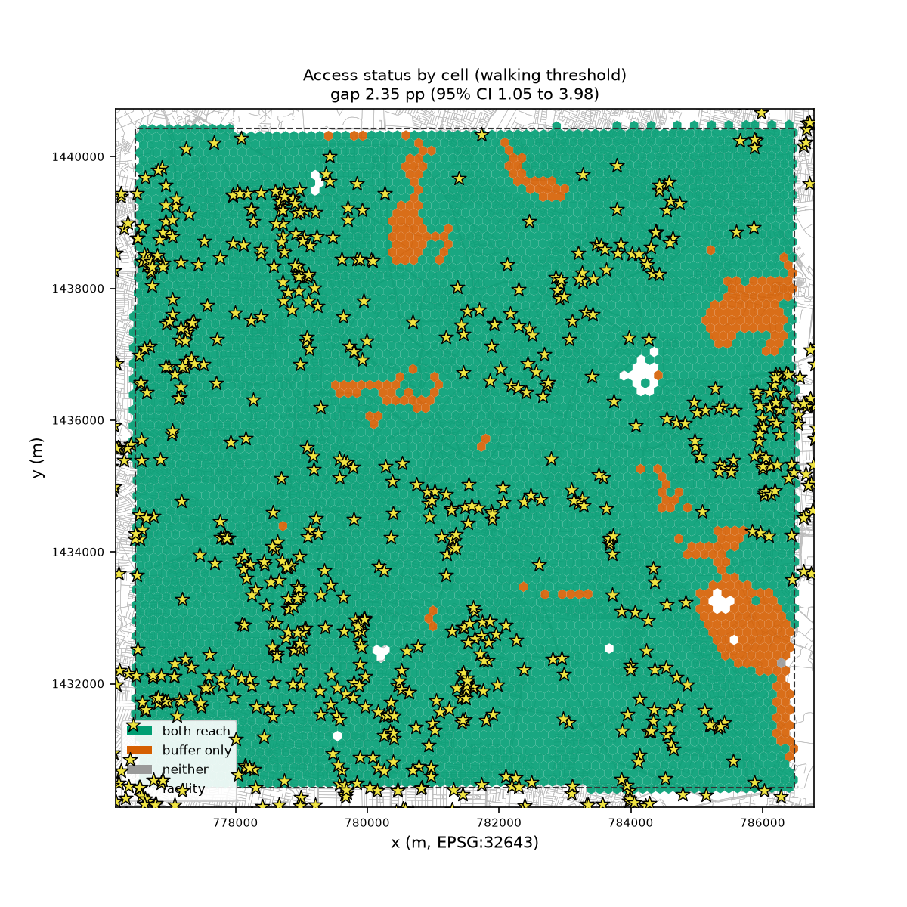
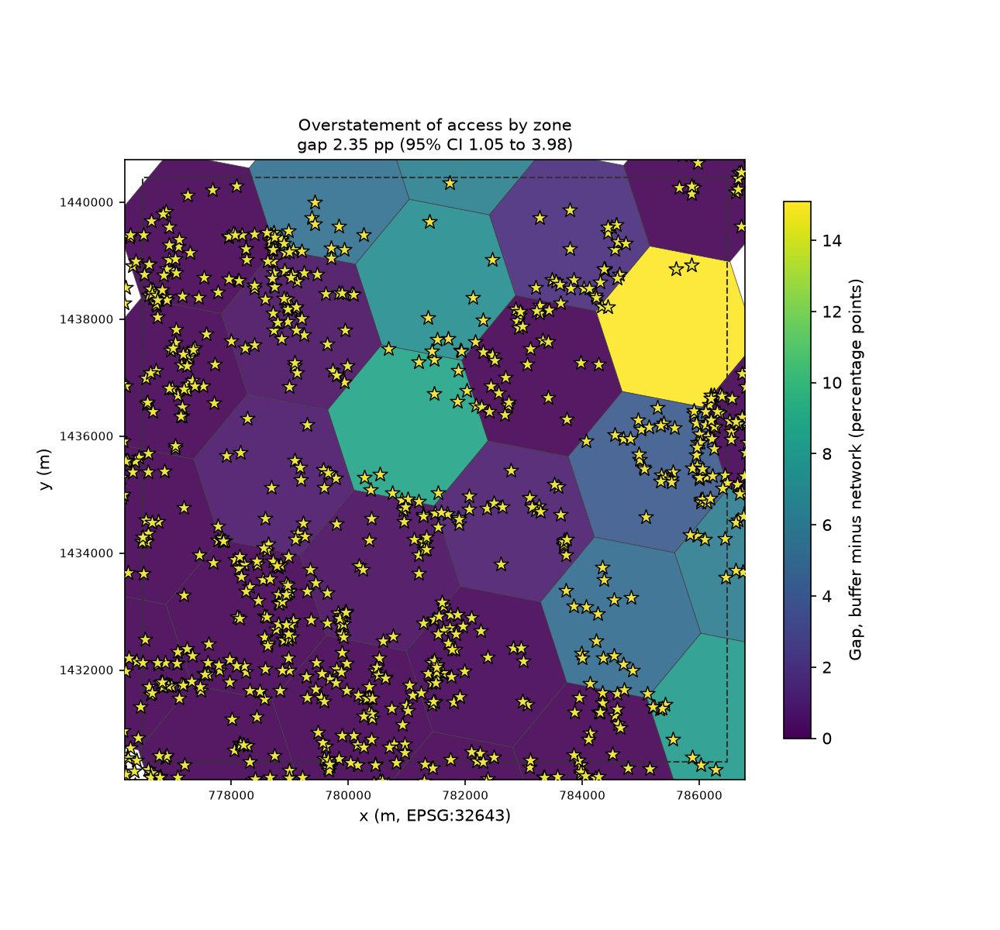
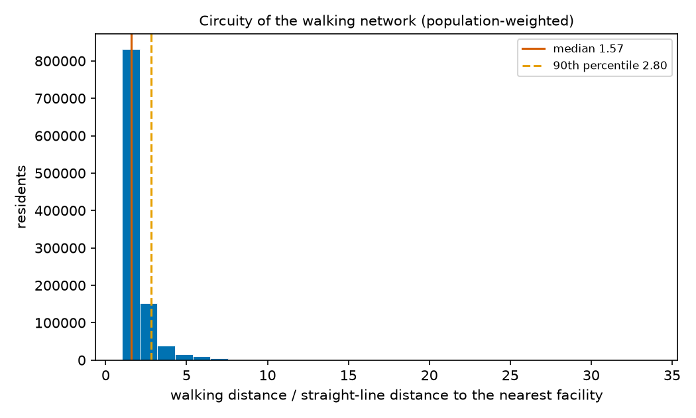

# Walkable access: straight-line buffer vs walking network

Headline: the straight-line buffer overstates access by **2.35 pp** (95% cluster-bootstrap CI [1.05, 3.98] pp) at 1,250 m. This run is **not the registered analysis (no verdict)**. The registered analysis is 5 km/h for 15 min, 2,000 resamples, seed 20261023, the registered study area and population resolution, and an extract fetched with a margin of at least 2,500 m; the numbers below are descriptive and carry no verdict.

Study area CRS EPSG:32643; 6,467 origin cells in 27 zones; 1,419 facilities; 77,717 network nodes and 106,973 edges.

## Summary

| Measure | Value |
|---|---|
| Walking threshold | 1,250 m (5 km/h for 15 min) |
| Residents with access, straight-line buffer | 100.00% |
| Residents with access, walking network | 97.65% |
| Gap (buffer minus network) | 2.35 pp |
| 95% CI, cluster bootstrap | [1.05, 3.98] pp |
| 95% CI, cell bootstrap (sensitivity) | [2.02, 2.69] pp |
| Bootstrap | 2,000 resamples, seed 20261023 |
| Snapping method | edge |
| Nearest-node snapping, superseded by Amendment 1 (sensitivity) | gap 2.52 pp [1.13, 4.30], network share 97.48% |
| Verdict | not the registered analysis (no verdict) |
| Residents the buffer counts as served but the network does not | 24,940 of 1,059,315 (2.35%) |
| Circuity (network / straight line), median and 90th percentile | 1.57 and 2.80 |
| Snapping distance, median | 11 m |
| Residents snapped more than 200 m | 0.77% |
| Network distance at least the straight line in every cell | yes |
| Origins (cells) and zones | 6,467 cells in 27 zones |

Values are shown to 2 decimals; the verdict uses the unrounded values.

## Sensitivity to walking speed and time

Gap in percentage points, cluster-bootstrap CI in brackets, then the distance threshold. The primary setting is in bold.

| Speed \ Minutes | 10 min | 15 min | 20 min |
|---|---|---|---|
| 4 km/h | 15.46 pp [11.01, 20.43], 667 m | 5.82 pp [3.03, 9.15], 1,000 m | 1.70 pp [0.74, 2.95], 1,333 m |
| 5 km/h | 9.80 pp [5.90, 14.21], 833 m | **2.35 pp [1.05, 3.98], 1,250 m** | 0.78 pp [0.25, 1.52], 1,667 m |
| 6 km/h | 5.82 pp [3.03, 9.15], 1,000 m | 0.99 pp [0.38, 1.81], 1,500 m | 0.33 pp [0.05, 0.73], 2,000 m |

## Where the gap falls

**Top 10 zones by gap**

| Zone | Residents | Buffer | Network | Gap | Residents affected |
|---|---|---|---|---|---|
| `8761892e8ffffff` | 40,514 | 100.00% | 84.90% | 15.10 pp | 6,117 |
| `8760145b4ffffff` | 42,975 | 100.00% | 91.17% | 8.83 pp | 3,796 |
| `876189251ffffff` | 19,789 | 100.00% | 91.88% | 8.11 pp | 1,606 |
| `8760145b6ffffff` | 45,789 | 100.00% | 92.74% | 7.26 pp | 3,323 |
| `8761892cdffffff` | 8,055 | 100.00% | 93.65% | 6.35 pp | 511 |
| `876189253ffffff` | 12,501 | 100.00% | 93.78% | 6.22 pp | 777 |
| `8760145b2ffffff` | 25,974 | 100.00% | 94.56% | 5.44 pp | 1,413 |
| `87618925effffff` | 46,714 | 100.00% | 94.91% | 5.09 pp | 2,379 |
| `8761892edffffff` | 58,720 | 100.00% | 95.88% | 4.12 pp | 2,418 |
| `8761892ebffffff` | 53,361 | 100.00% | 98.20% | 1.80 pp | 960 |

**Top 10 zones by residents affected**

| Zone | Residents | Buffer | Network | Gap | Residents affected |
|---|---|---|---|---|---|
| `8761892e8ffffff` | 40,514 | 100.00% | 84.90% | 15.10 pp | 6,117 |
| `8760145b4ffffff` | 42,975 | 100.00% | 91.17% | 8.83 pp | 3,796 |
| `8760145b6ffffff` | 45,789 | 100.00% | 92.74% | 7.26 pp | 3,323 |
| `8761892edffffff` | 58,720 | 100.00% | 95.88% | 4.12 pp | 2,418 |
| `87618925effffff` | 46,714 | 100.00% | 94.91% | 5.09 pp | 2,379 |
| `876189251ffffff` | 19,789 | 100.00% | 91.88% | 8.11 pp | 1,606 |
| `8760145b2ffffff` | 25,974 | 100.00% | 94.56% | 5.44 pp | 1,413 |
| `8761892ebffffff` | 53,361 | 100.00% | 98.20% | 1.80 pp | 960 |
| `876189253ffffff` | 12,501 | 100.00% | 93.78% | 6.22 pp | 777 |
| `87618925affffff` | 55,855 | 100.00% | 99.00% | 1.00 pp | 561 |

## Figures

